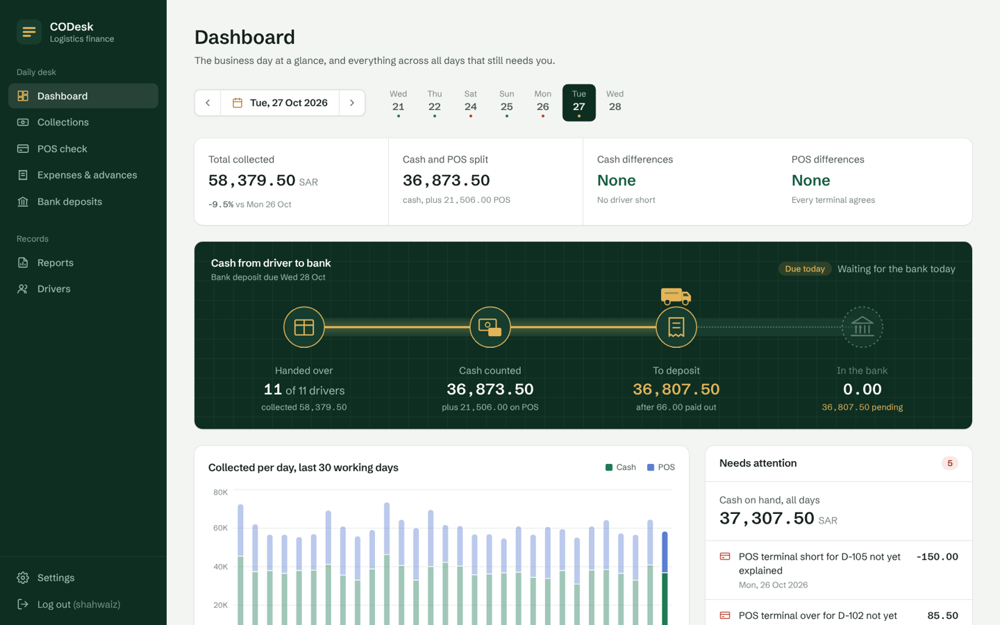
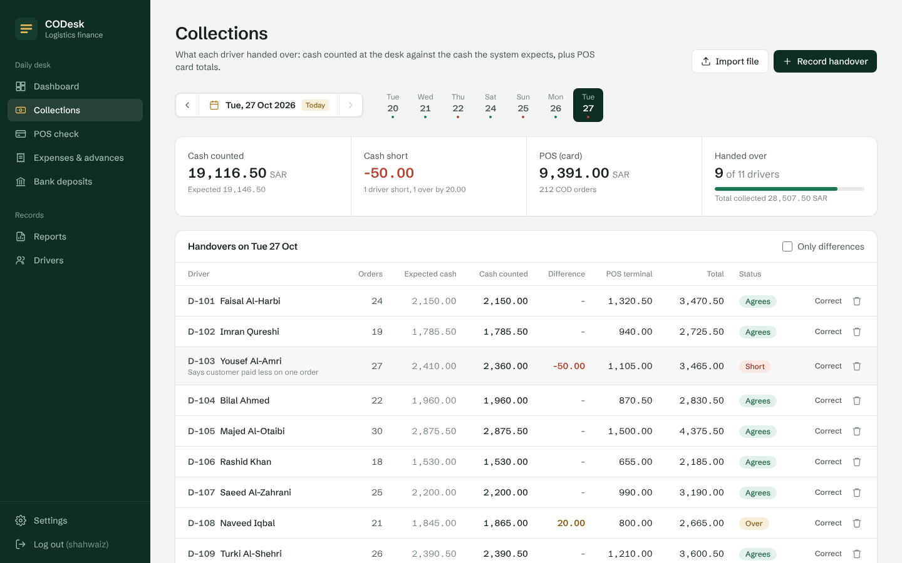
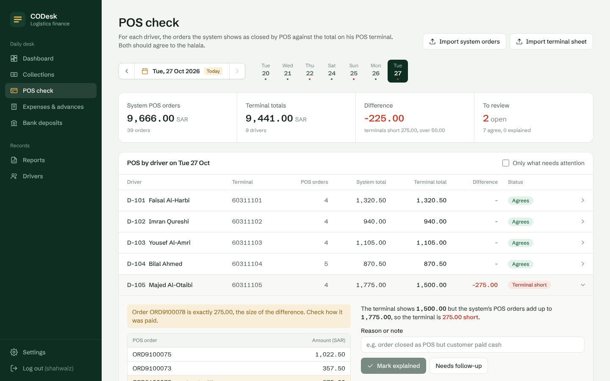
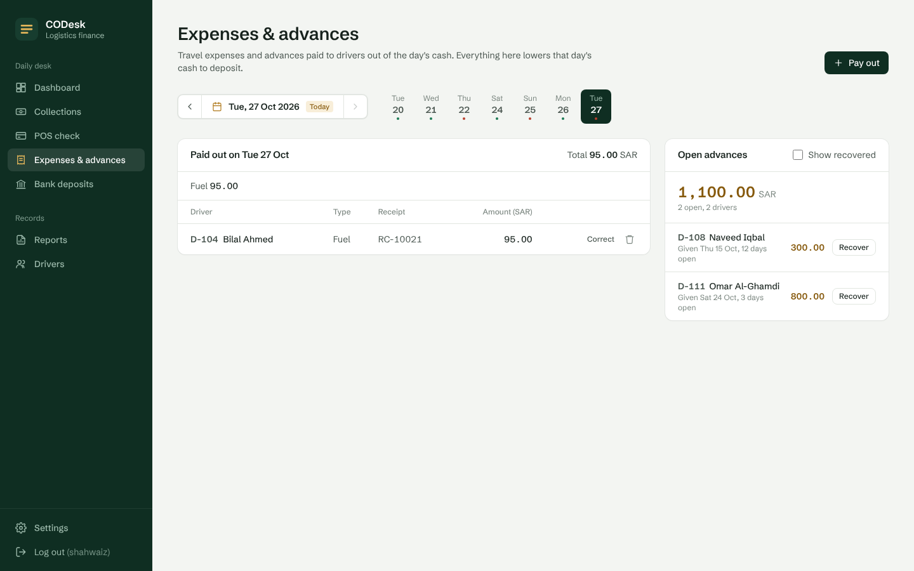
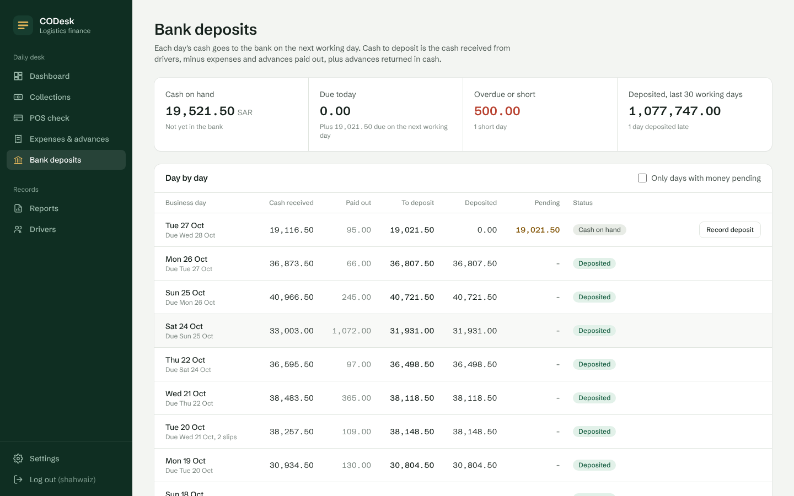
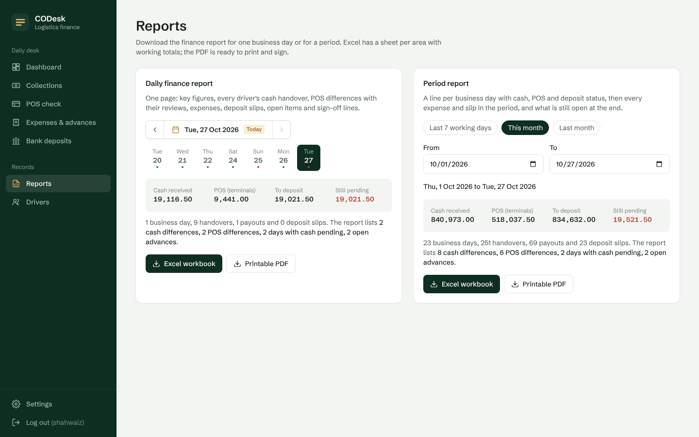

# CODesk

A finance desk for the daily cash-on-delivery (COD) work of a logistics company: driver handovers in cash and POS, POS checks against closed orders, driver expenses and advances, next-day bank deposits, and the daily finance report.

I built it around the work I do every day as a finance executive at a delivery company. Every screen matches a step of that day, and every check is one I used to do by hand in Excel.

**All data in this project is fictional.** No real company, driver, customer or bank data is used anywhere.



## The daily cycle it follows

1. Drivers finish their routes and come back to the desk. Card payments were already taken on their POS machines.
2. The desk counts each driver's cash and checks it against the cash the delivery system says he collected.
3. The system's POS-closed orders for each driver are checked against the total on his POS terminal.
4. Travel expenses and advances are paid out of the day's cash.
5. On the next working day the rest goes to the bank:
   **cash to deposit = cash received from drivers − expenses and advances paid out + advances returned in cash**
6. A daily finance report is printed and signed.

## What it does

**Dashboard.** The chosen business day at a glance: total collected against the previous day, the cash and POS split, cash and POS differences, and the day's money from driver to bank written as one ledger line (received − paid out = to deposit − deposited = pending). A 30-day chart of cash and POS per day (click a bar to open that day), the drivers with a difference that day, and a *needs attention* list across all days: overdue or short deposits, unexplained POS differences and advances open for more than 14 days.

**Collections.** Every driver's handover for the day, imported straight from the delivery system's order-level collection report (each driver's cash lines are added up into his expected cash) or entered one by one: expected cash from the system, cash counted at the desk, the exact difference, POS terminal total and the day total. Short drivers show in red, extra cash in brass, and drivers who have not handed over yet are listed with a one-click button. The form shows the difference while you type.



**POS check.** For each driver, the orders the system shows as closed by POS against his terminal's total for the day. Until the system's POS orders for a day are imported, terminal totals show as waiting rather than as differences. POS machines move between drivers, so the terminal sheet does not need a driver column: each machine is matched to a driver by its registered terminal ID, or by the exact amount of one driver's system POS orders, and the few left are matched by hand from the closest totals. Machines not matched yet still count in the day's difference. The sheet can be a plain list or the desk's own layout (a total line on top, *POS Code* and the date as headings). Click a driver to see his POS orders. If one order is exactly the size of the difference it is highlighted, because that is usually the order closed as POS but paid in cash. Each difference is marked *explained* (a reason is required) or *needs follow-up*. If the numbers change after a review, the review shows as out of date and the difference is open again.



**Two ways a desk works.** On Settings you choose how your cash desk works. If orders are closed only when the driver pays in full (unpaid orders stay pending), Collections simply shows each driver's cash and card money from the system report, with nothing to count. If orders can be closed before the money is counted, Collections compares the cash counted at the desk with the system's cash and shows short drivers in red.

**Expenses and advances.** Fuel, tolls, parking, travel, maintenance or other expenses, and advances, paid to a driver from the day's cash with a receipt number. Open advances show how many days they have been open. The desk's own expense sheet (date, driver ID, name, amount) can be imported as it is, with or without a heading row (rows without a type are saved as Expense); a driver not in CODesk yet is added from his name, and rows already saved are skipped. An advance is recovered either from salary (nothing comes back to the desk) or as cash returned at the desk, which is added to that day's deposit.



**Bank deposits.** A day-by-day ledger: cash received, paid out, cash to deposit, deposited and pending, with one status per day: cash on hand, due today, overdue, deposit short, deposited (and how many days late). A day can be deposited with several slips. Cash goes in as notes, so a day deposited to within a few riyals (the halalas left behind, or a slip rounded up to the next note, under 5 SAR) counts as deposited, and the rounding is shown. A slip number can be used only once, a slip cannot be more than what is still pending, and a deposit cannot be dated before its business day.



**Reports.** The daily finance report, or a period report of up to 93 days, as an **Excel workbook** (Summary, By day, Collections, POS check, Expenses and Deposits sheets, with real SUM formulas) or a **one-page PDF** with open items and *Prepared / Checked / Approved* signature lines. A preview shows the totals before you download.



**Imports with a check first.** The driver list, handovers, the system's POS orders and the terminal sheet can be imported from CSV or Excel. Nothing is saved until you have seen the check: unknown or inactive drivers, unreadable amounts, a driver or order twice, a terminal nobody has. Rows already saved are skipped and changed ones are updated. Column names are flexible ("Cash Collected", "System Cash", "Courier ID", "TID"...), amounts like "SAR 1,234.50" or "(500.00)" are understood, dates are read day-first (26/10/2026), and cash orders in a POS export are skipped.

**Watch folder.** Choose a folder on the Settings page and save the day's files in it: the collection report, the terminal sheet, the expense sheet. Every few seconds CODesk looks in the folder, recognises each file by its columns, imports the good rows with the same checks as the Import buttons, matches the POS machines, and moves the file to *Imported* (or *Problems* if it could not be read). The same file is never imported twice, files still being copied or open in Excel wait, and a file with problems shows on the dashboard.

**Deposit slip reader (AI).** Scan or photograph the handwritten bank slip and read it on the Bank deposits page, or drop it in the watch folder. A vision AI model that runs on this computer through [Ollama](https://ollama.com) (free; slips never leave the computer) reads the date, bank, slip number, total, amount in words and every note line. CODesk then checks what the AI read with plain arithmetic: each line (notes × count), the lines against the total, the words against the total, and finds the one day still to deposit with the same amount (within rounding). Nothing is recorded by the AI: the slip waits with its picture and the checks until a person records it with one click. Setup once: install Ollama, then `ollama pull qwen3-vl:4b` (about 3.3 GB, fits a laptop with 8 GB of memory).

**Unusual amounts.** CODesk learns what is normal from the desk's own last 90 days and points out what is not: a payment several times the driver's usual for that kind of expense (or the desk's usual when he has no history yet), a day whose total paid out is several times a usual day, and a driver whose POS machine disagreed with his orders on several of his recent days. "Usual" is the median, so one odd payment does not move it, and small amounts never alarm. Alerts show on the dashboard and on the Expenses page, and can be marked "looks fine" with a note.

**Morning summary.** The last business day on one page, at the top of the Reports page: cash collected, POS against the system, paid out, where the cash stands on its way to the bank, what is due at the bank today and what needs attention. Copy it as text into WhatsApp or an email, or download the PDF. Set a time, and every working morning (not Friday) CODesk saves the PDF and the text by itself in a *Morning summaries* folder next to the watch folder.

**Ask CODesk (AI).** Questions in plain English ("Which 3 drivers collected the most cash this month?"). The AI is given tools, the same calculations the pages use (a day's figures, a period, one driver, a ranking, the open items), not the database; it calls them and answers from the results only, and every tool call is shown under the answer.

**Two AI engines.** The local AI on this computer (Ollama, private), or Google Gemini's free tier through its OpenAI-compatible API, which works on any laptop. Google may use what is sent on its free tier, so CODesk only allows the cloud engine in demo mode, with the fictional data: real company data never leaves the computer. In demo mode, *Make a demo slip* draws a fictional hand-filled slip for the day waiting to be deposited, to try the slip reader.

**Drivers.** Driver IDs, hubs and POS terminal IDs (one terminal per active driver), added one by one or imported from a CSV or Excel list (existing drivers are updated, never doubled, and an empty cell never wipes a saved value). Each handover keeps the terminal used that day, so moving a machine to another driver does not change old days. A driver with records cannot be deleted, only made inactive.

**Activity log and login.** Every change is saved with who made it, when, and the old and new amounts. Log entries cannot be edited or deleted, which is also blocked in the database layer. One owner account, scrypt password hashing, an HttpOnly session cookie, lockout after five wrong passwords, and changes from unknown websites are refused.

## Things done carefully

- **Money is stored as whole halalas** (1 SAR = 100 halalas) in integer columns. Decimal numbers stored as floats drift by fractions of a halala when thousands of them are added; integers never do, so every total adds up exactly.
- **Fridays are the weekly day off.** Thursday's cash is due at the bank on Saturday, and the date controls skip Fridays.
- **The dashboard and reports use the same calculations as the pages**, so a number never disagrees between screens.
- **Excel safety.** Text that Excel could run as a formula (starting with `=`, `+`, `-` or `@`) is made harmless in exported reports.
- **Older databases upgrade themselves.** When a new version adds columns, they are added at start-up.
- **Tests.** 108 backend tests (pytest) and 16 frontend tests (Vitest). The demo data has mistakes planted on purpose, and the tests check the app finds exactly those.

## Demo data

Started on an empty database, the backend adds 12 fictional drivers and 30 working days of handovers, POS orders, expenses, advances and deposits, with these mistakes planted:

| Mistake | Where |
|---|---|
| Cash short | 5 handovers: 20, 50, 75, 120 and 300 SAR |
| Cash over | 1 handover: 30 SAR |
| POS terminal short | 3 driver-days: 60, 150 and 320 SAR |
| POS terminal over | 1 driver-day: 85.50 SAR |
| Advances not recovered | 2 drivers: 300 and 800 SAR |
| Deposit short | 1 day: 500 SAR |
| Late deposit | 1 day, deposited 3 working days after it was due |
| Not deposited yet | the latest day |
| Unusual payment | 1 fuel payment of 420 SAR, about 5x the driver's usual |

The `samples` folder has a fictional day to import yourself, in this order:

1. `sample_handovers.csv` on **Collections**: 9 good rows (one driver 50 short, one 20 over) and 2 planted problems (an order count that is not a number, an unknown driver ID).
2. `sample_pos_orders.csv` on **POS check** (*Import system orders*): 39 POS orders and 1 cash order that is skipped. One order of D-105 was closed as POS but not paid by card.
3. `sample_terminal_sheet.csv` on **POS check** (*Import terminal sheet*): D-107's terminal shows 50 more than his orders (a card swiped twice), and one terminal belongs to nobody.

## Run it on Windows 11

You need Python 3.12 or 3.13 and Node.js 20 or newer. Use two PowerShell windows and run the commands one at a time.

**Window 1: backend**
```powershell
cd codesk\backend
py -3.13 -m venv .venv
.venv\Scripts\Activate.ps1
pip install -r requirements.txt
python -m pytest
python -m uvicorn app.main:app --port 8000
```

**Window 2: frontend**
```powershell
cd codesk\frontend
npm install
npm test
npm run dev
```

Open http://localhost:5173 and create your owner account.

**Demo mode next to your real data.** In Window 1, before starting the backend, run `$env:DATABASE_URL="sqlite:///./codesk-demo.db"` and `$env:SEED_DEMO_DATA="true"`. These only last until the window is closed, so a new window starts with your real data again. To start again from fresh demo data, stop the backend and delete `backend\codesk.db`. The API documentation is at http://127.0.0.1:8000/docs.

**Forgot the password?** Stop the backend (Ctrl + C), run `python -m app.reset_password` in the backend folder and type a new one. It shows your username, ends all saved logins and writes the reset to the activity log.

## Technology (all free)

React, TypeScript, Vite, Tailwind CSS, Recharts, Python, FastAPI, SQLAlchemy, SQLite, pandas, openpyxl, ReportLab, PyMuPDF, Pillow, Ollama with Qwen3-VL (local AI), pytest, Vitest.

## How it is built

```
backend/app/
  main.py         app start-up, login check, drivers, activity log
  collections.py  driver handovers and their import
  pos.py          POS check: system POS orders against terminal totals, reviews, imports
  terminals.py    the terminal sheet and matching each day's POS machines with drivers
  expenses.py     expenses and advances, recovery by salary or cash
  watcher.py      the watch folder: recognises and imports the day's files by itself
  slip_reader.py  reads deposit slips with a local AI model, then checks the sums
  unusual.py      unusual amounts, learned from the desk's own history
  morning.py      the morning summary, and preparing it by itself each working morning
  ai.py           the AI engine: local (Ollama) or Google Gemini, demo data only
  ask.py          Ask CODesk: questions answered with CODesk's own calculations as tools
  deposits.py     the cash-to-deposit ledger and deposit slips
  dashboard.py    the day at a glance and the needs-attention list
  reports.py      Excel and PDF reports
  files.py        reading CSV and Excel uploads safely
  money.py        reading amounts exactly, into halalas
  models.py       database tables
  seed.py         the fictional demo data and its planted mistakes
frontend/src/
  pages/          one file per screen
  components/     layout, date picker, import window, dialogs
docs/
  INTERVIEW_GUIDE.md  how to present the project
```

## Not built yet

Several users with roles (one owner account today), a branch or hub filter on the dashboard, partial recovery of an advance, a direct connection to a delivery system or bank (data comes in as files), and an Arabic interface.
